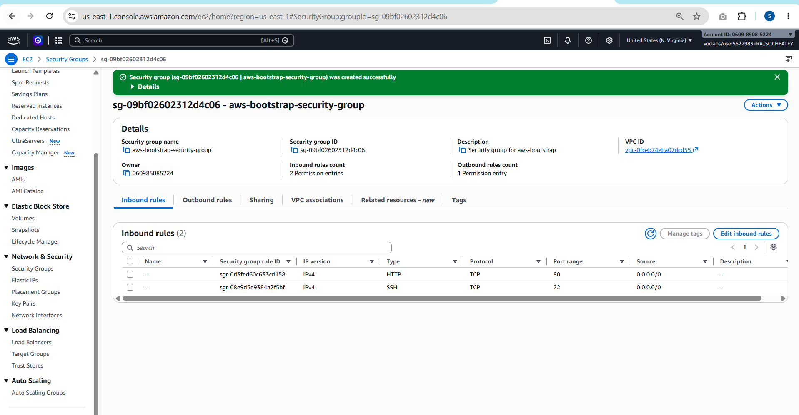
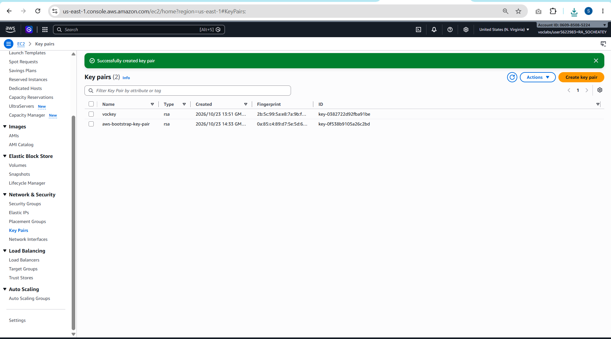
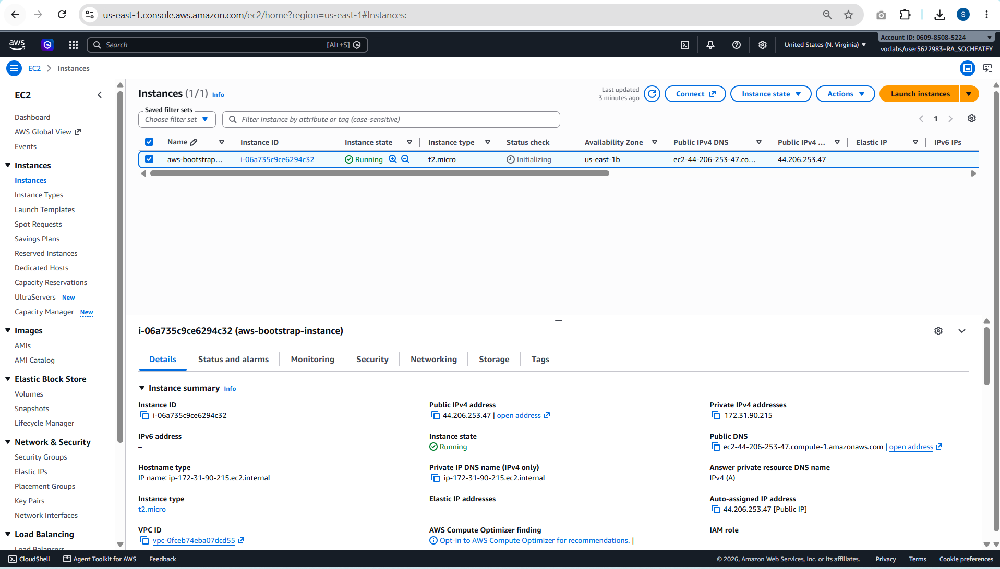
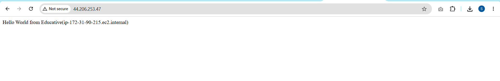
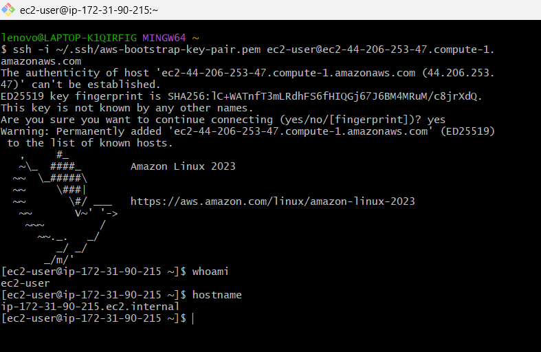
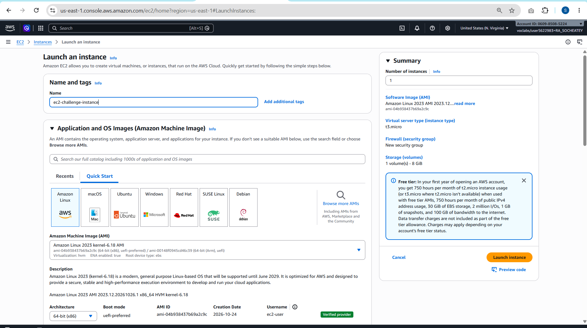
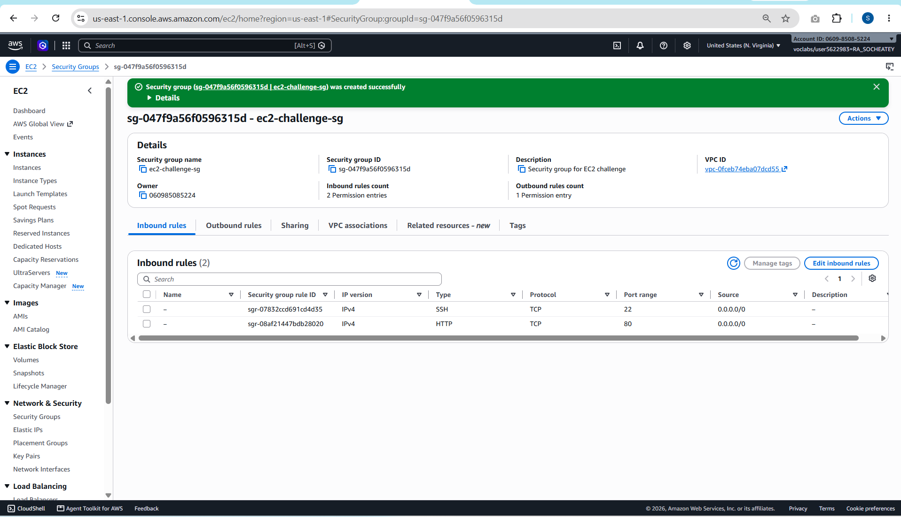
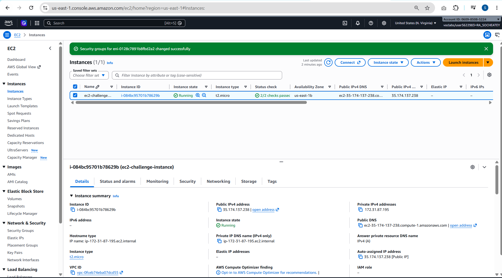
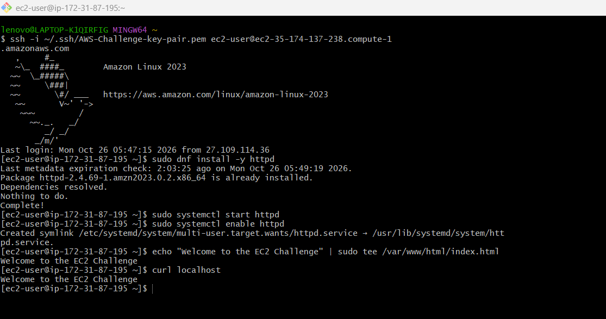
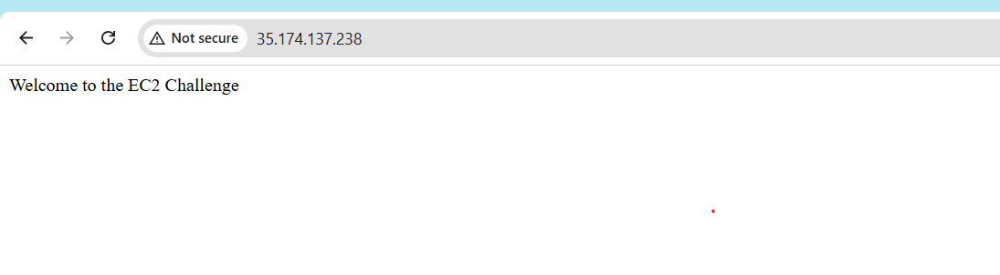

# Cloud Lab 1 Submission — Amazon EC2

Copy this template to `cc-lab-YOUR_ID/lab1/README.md` in your own repository. Follow [the instructions](lab1-instruction.md). Put your screenshots in `lab1/images/` with the file names below.

- **Student name:** Ra Socheatey
- **Student ID:** e20221446
- **Learner Lab user name:** voclabs/user5622983=RA_SOCHEATEY
- **Date completed:** 2026-10-26

---

## Part 1.1 — An Amazon EC2 Walkthrough

### Security group



### Key pair



### Instance details



### Browser test



### SSH connection



Did you connect with your own SSH client or with EC2 Instance Connect?

---

## Part 1.2 — EC2 Web Solution (Challenge)

### Launch configuration



### Security group



### Running instance



### Commands on the instance



Paste the commands you ran to install the web server and create `index.html`:

```bash

```

### Browser test



---

## Questions

1. Your security group has an SSH rule and an HTTP rule. What does each one let you do? What would stop working if you deleted the HTTP rule?
   **Answer:** The SSH rule opens TCP port 22. It lets me log in to the instance remotely, which I did from Git Bash with my key pair. The HTTP rule opens TCP port 80. It lets a web browser reach the Apache web server and load the page. If I deleted the HTTP rule, the web page would no longer load in the browser (the request would time out), but SSH would still work because port 22 would still be open.

2. In Part 1.1 you never logged in to install the web server. What installed it, and when did it run?
   **Answer:** The user data script that I pasted in Advanced details installed it. The instance ran this script automatically, one time, when it booted for the first time. The script updated the system, installed `httpd`, started and enabled the service, and created `index.html`, so the web server was ready without me logging in.

3. Why does the web page open with `http://` but not with `https://`?
   **Answer:** Apache was only set up for HTTP, which uses port 80. HTTPS uses port 443 and needs an SSL/TLS certificate. We did not install a certificate, Apache was not listening on port 443, and the security group had no rule for port 443. So the browser cannot make an HTTPS connection, and only `http://` works.

4. Part 1.2 asked for a 10 GiB root volume. Where in the launch settings did you set it, and how can you check the size on the running instance?
   **Answer:** I set it in the **Configure storage** section of the launch page, where I changed the root volume from 8 GiB to 10 GiB (gp3). To check it, I can select the instance in the EC2 console and open the **Storage** tab, which shows the volume size. On the instance itself, I can run `lsblk` or `df -h` to see the size of the disk.

## Problems and how I solved them (optional)

- **SSH timed out on the challenge instance.** The instance was launched with the `default` security group instead of `ec2-challenge-sg`, so port 22 was not open. I saw "Security groups: default" on the Connect page and fixed it with **Actions → Security → Change security groups**, replacing `default` with `ec2-challenge-sg`. After that, SSH worked.
- **New public IP after the lab restarted.** When the Learner Lab session ended, the instance was stopped. When it started again, it had a new public IP and DNS, so I used the new address for SSH and the browser test.
- **Folder structure.** My `lab1` folder was first outside `cc-lab-e20221446`, and one screenshot used `_` instead of `-` in its name. I moved the folder and renamed the file so all images show in this report.

## AI note (optional)

One suggestion an AI tool gave you and how you checked it.

## Clean up

- [ ] Part 1.1: instance terminated, key pair and security group deleted.
- [ ] Part 1.2: instance terminated, security group (and key pair, if any) deleted.
