# Cloud Lab 2 — Application Load Balancer with an EC2 Auto Scaling Group

**Student ID:** e20221446
**Region:** us-east-1 (N. Virginia)

## Resources created

| Resource | Name | Key settings |
|---|---|---|
| Security group (LB) | LoadBalancerSecurityGroup | Inbound HTTP 80 from 0.0.0.0/0 |
| Security group (instances) | LaunchTemplateSecurityGroup | Inbound HTTP 80, SSH 22 from 0.0.0.0/0; outbound all traffic |
| Target group | LoadBalancerTargetGroup | Instances, HTTP:80, health check `/` every 30 s |
| Load balancer | MyLoadBalancer | Application, internet-facing, all 6 AZs, listener HTTP:80 → target group |
| Launch template | AutoScalingLaunchTemplate | Amazon Linux 2023, t2.micro, user data installs httpd |
| Auto Scaling group | MyAutoScalingGroup | Desired 2, min 2, max 3, ELB health checks on |

## Task 1 — Security groups

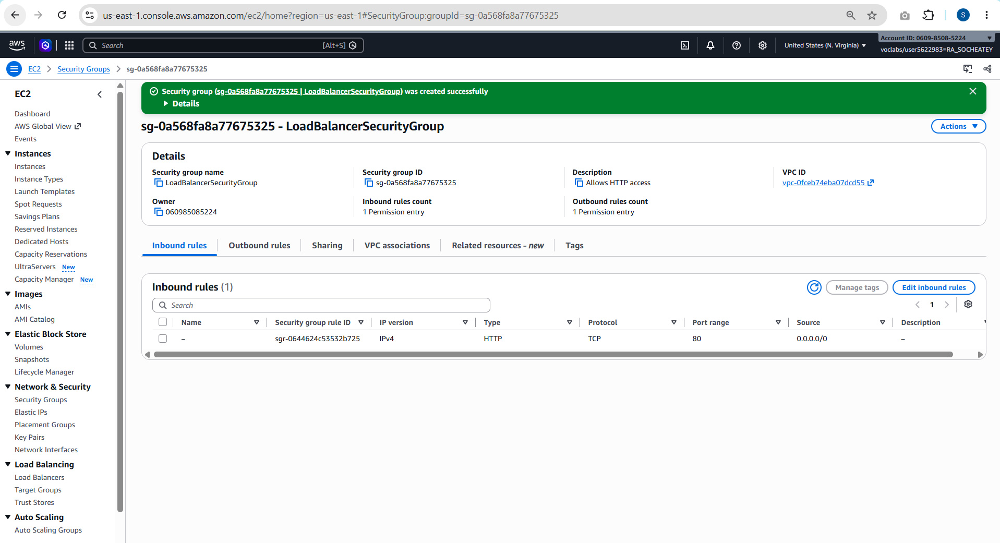
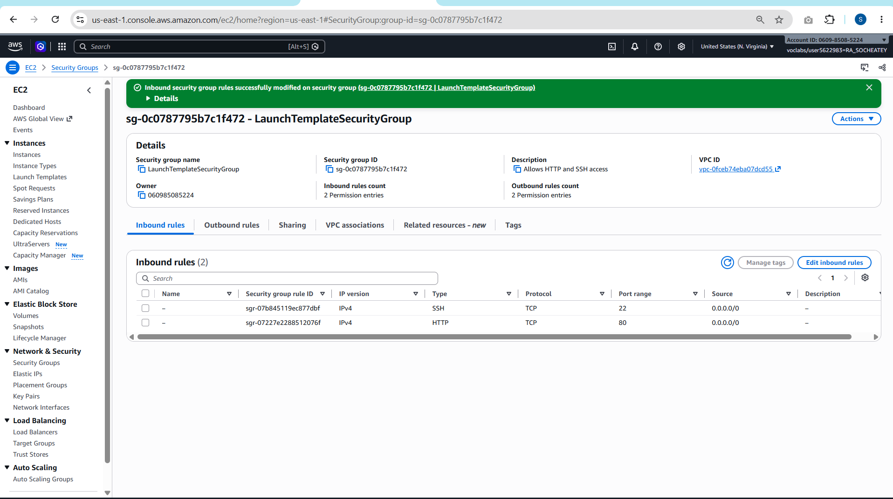

## Task 2 — Target group

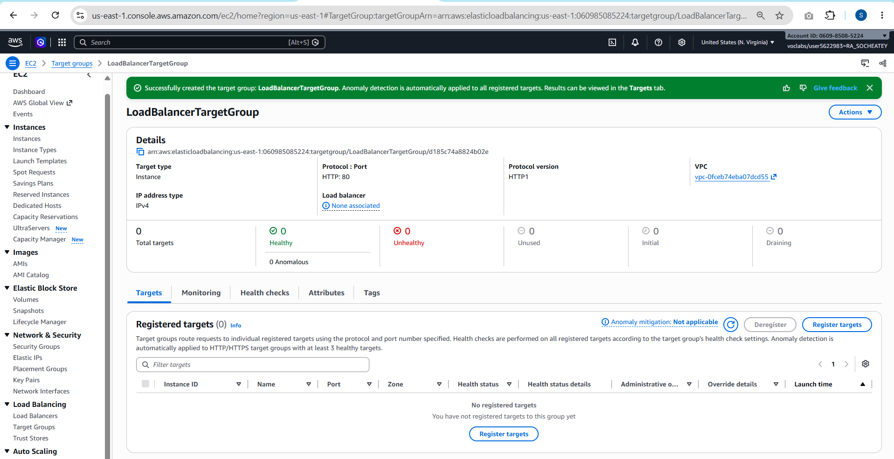
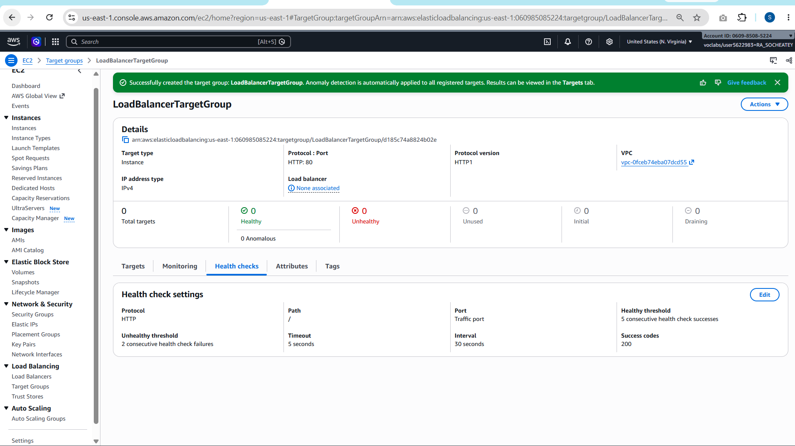

Health check: HTTP request to `/` every 30 seconds, timeout 5 s, success code 200.
2 failures in a row → unhealthy; 5 successes in a row → healthy.

## Task 3 — Application Load Balancer

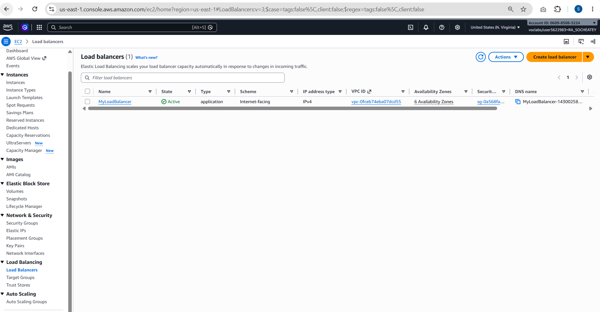
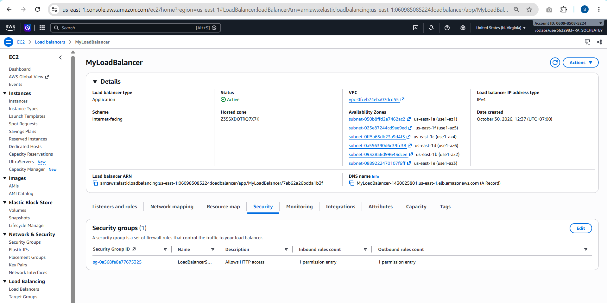

DNS name: `MyLoadBalancer-1430025801.us-east-1.elb.amazonaws.com`

## Task 4 — Launch template and Auto Scaling group

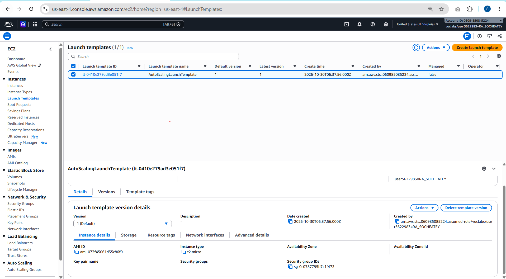

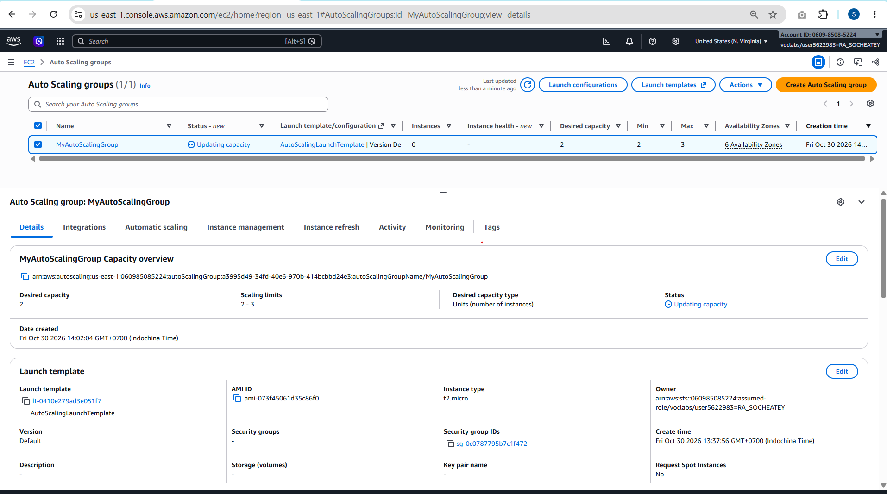
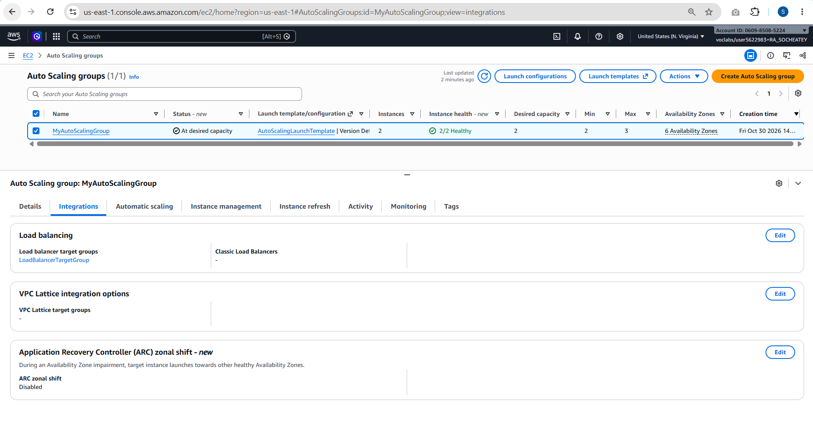

## Task 5 — Testing

### Load balancing

Refreshing the load balancer's DNS name showed two different hosts
(`ip-172-31-26-149` and `ip-172-31-64-215`), so requests were spread across both instances.

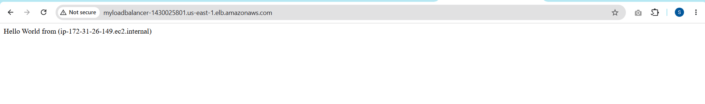

### Simulated application failure

I stopped the web server on instance `i-0c826e511ed19ff64` with
`sudo systemctl stop httpd.service`. The instance kept running, but it failed
two health checks in a row, became unhealthy, and was drained (deregistered).
Because ELB health checks are enabled on the ASG, the ASG terminated it and
launched a replacement, `i-0e07be481d6696c9c`, which became healthy.

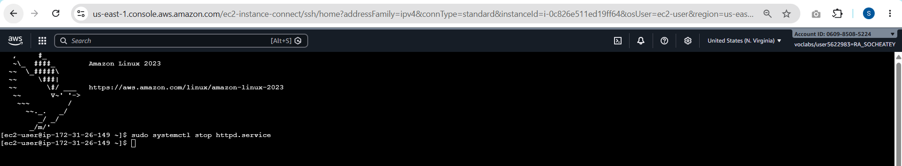
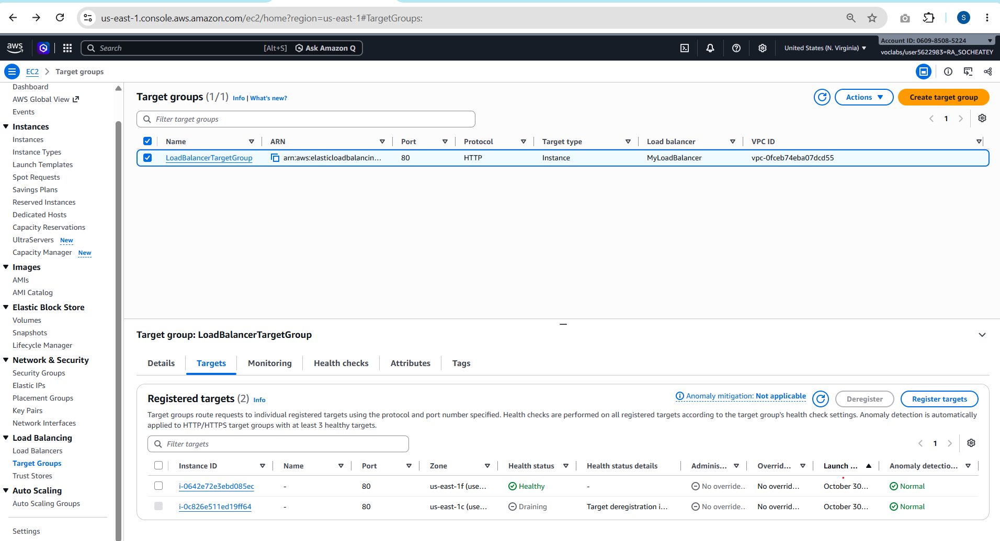
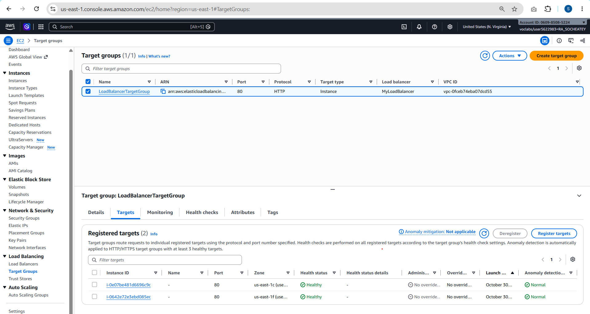

## Problem encountered

At first, all targets were unhealthy. The outbound rules of
`LaunchTemplateSecurityGroup` allowed only ports 80 and 22, so the instances
could not reach the Amazon Linux repositories over HTTPS (443) and `yum` could
not install httpd. I changed the outbound rule to **All traffic → 0.0.0.0/0**
and terminated the broken instances. The ASG launched new ones that installed
httpd correctly. User data runs only at first boot, so the old instances had
to be replaced.

## Task 6 — Clean up

All resources were deleted in reverse order: Auto Scaling group, launch
template, load balancer, target group, security groups.