# Cloud Lab 4 Submission — Amazon VPC

- **Student name:** Ra Socheatey
- **Student ID:** e20221446
- **Learner Lab user name:** voclabs/user5622983=RA_SOCHEATEY
- **Date completed:** 2026-11-12

---

## VPC and internet gateway

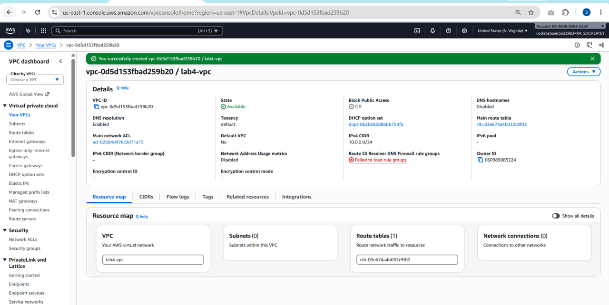

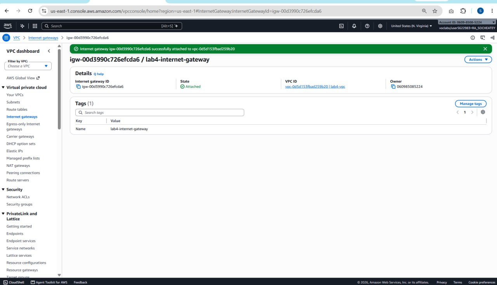

## Public subnet

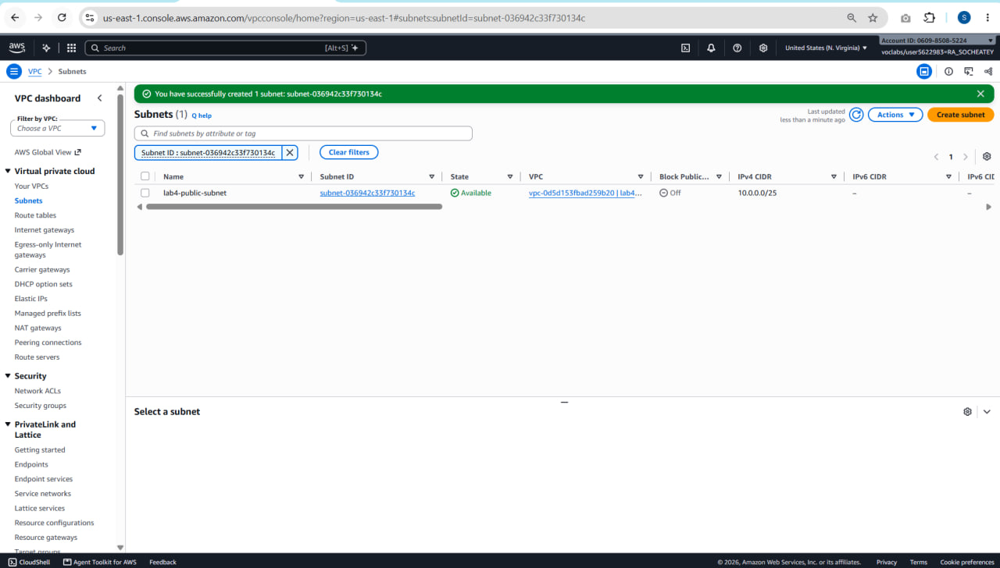

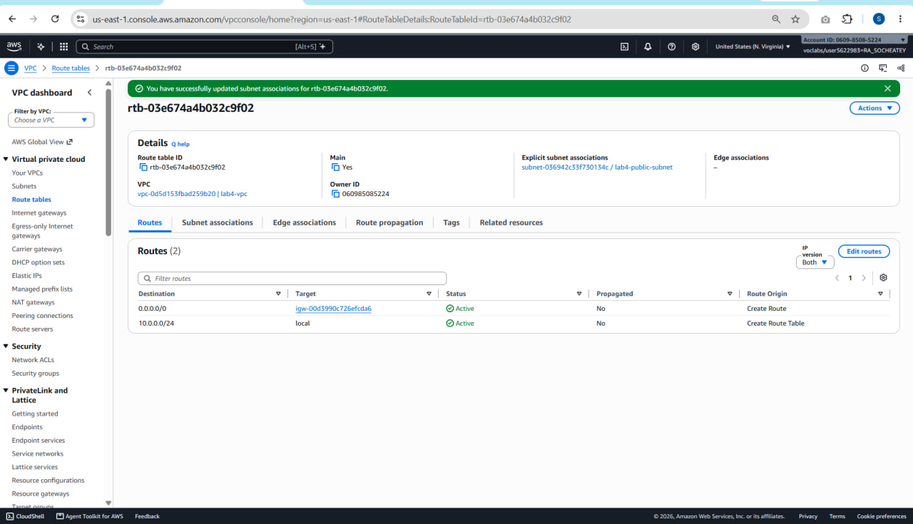

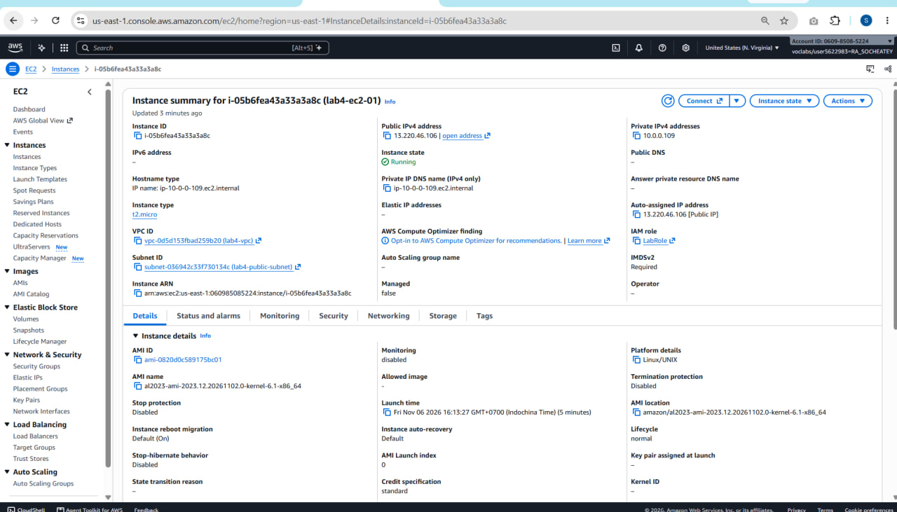

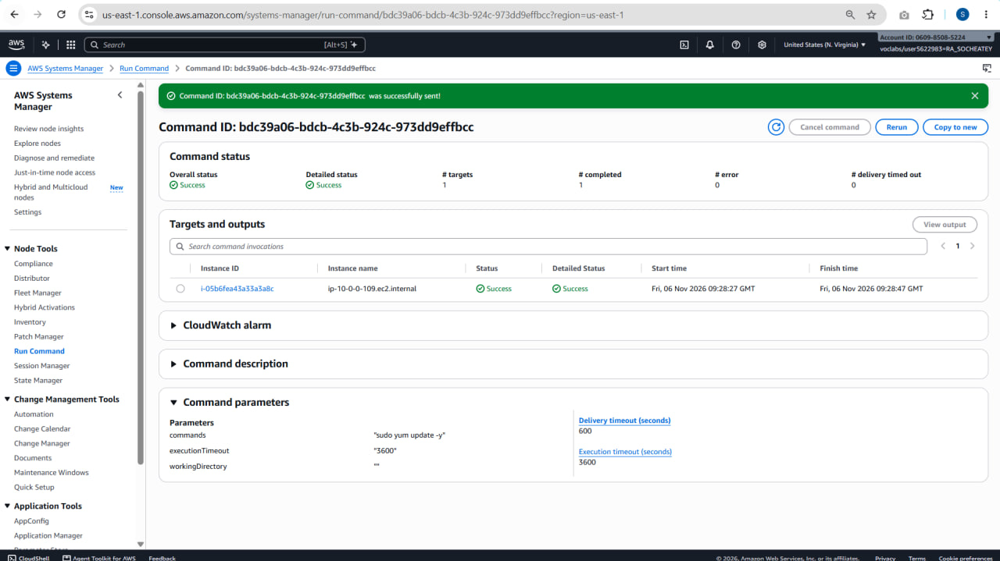

## Private subnet

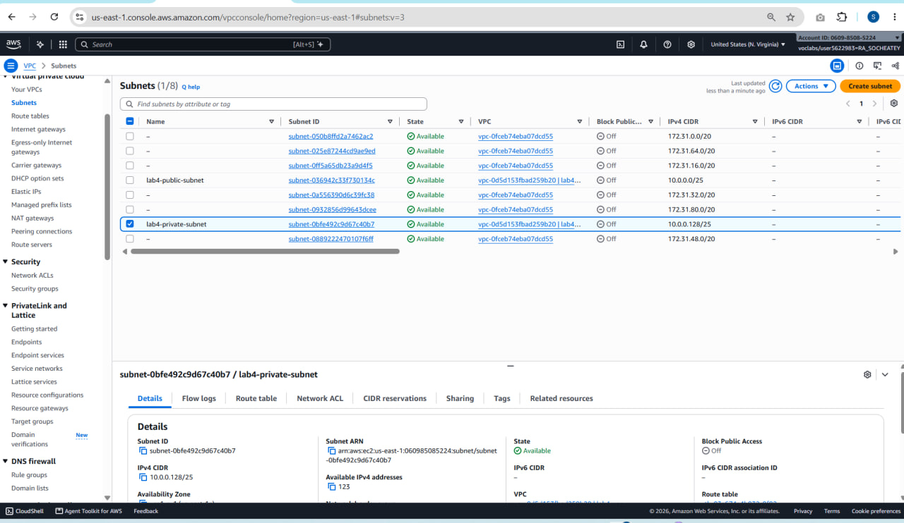

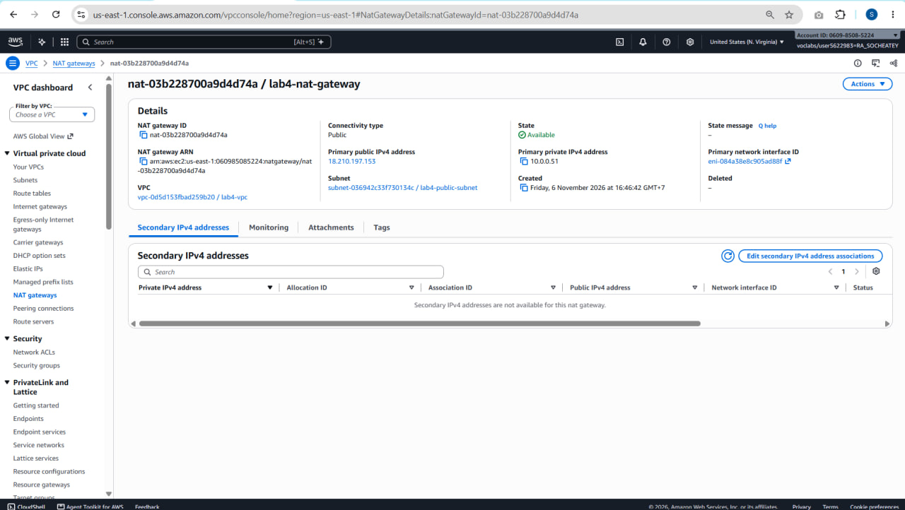

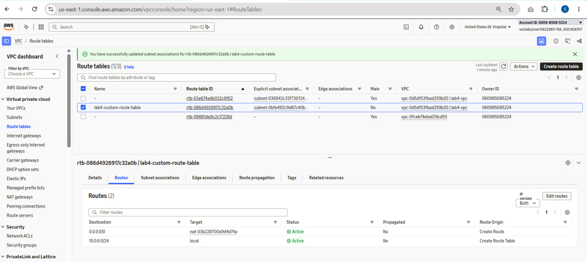

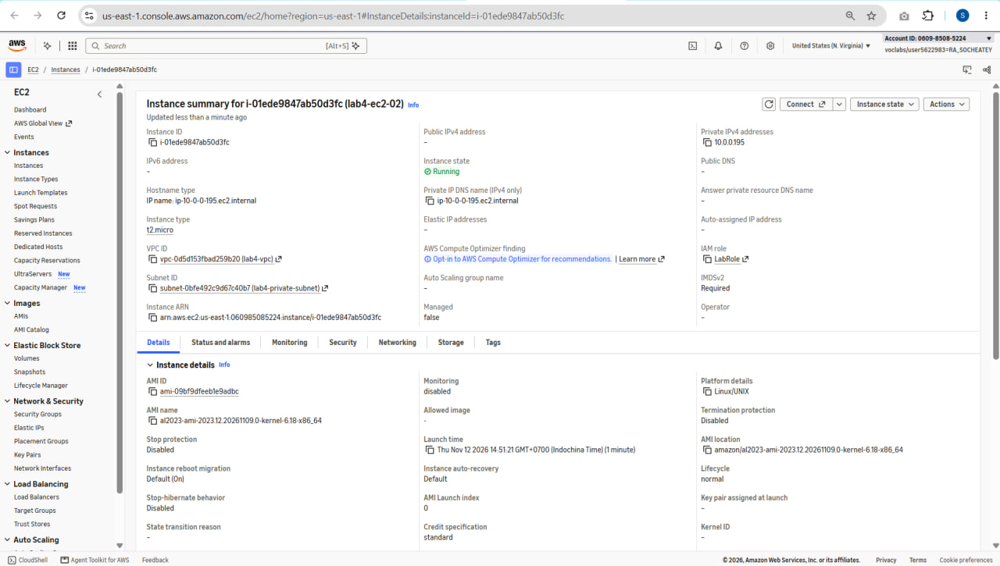

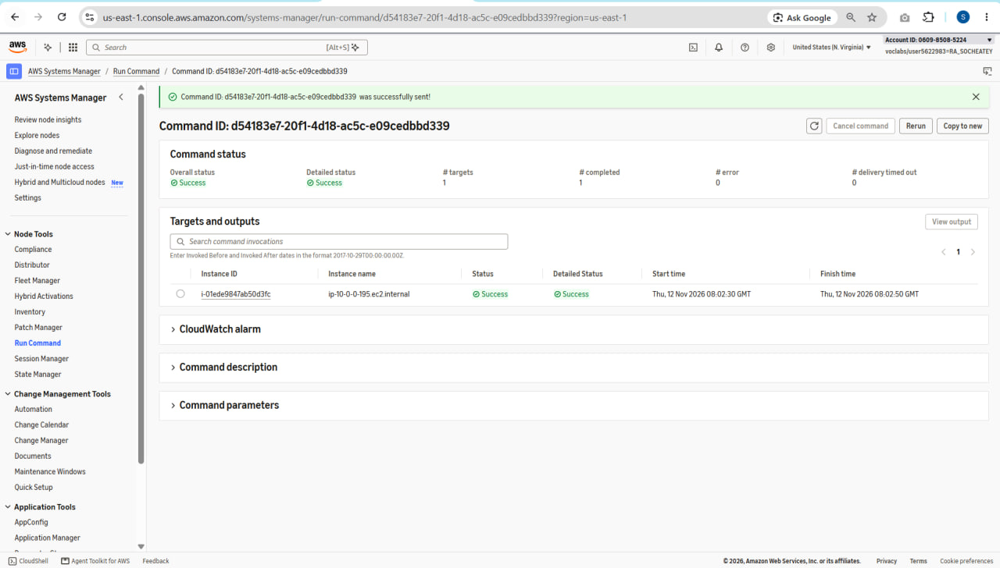

---

## Questions

**1. The VPC is `10.0.0.0/24` and the subnets are `10.0.0.0/25` and `10.0.0.128/25`. How many IP addresses does each block contain, and why do the two subnets not overlap?**

A `/24` block has 32 − 24 = 8 host bits, so the VPC contains 2⁸ = **256** addresses (`10.0.0.0` – `10.0.0.255`). Each `/25` subnet has 7 host bits, so it contains 2⁷ = **128** addresses. AWS reserves 5 addresses in every subnet (network address, VPC router, DNS, one for future use, and broadcast), so each subnet has **123** usable addresses. The private subnet's details page in my screenshot shows exactly 123 available IPv4 addresses.

The subnets do not overlap because they are the two halves of the VPC range:

- `10.0.0.0/25` = `10.0.0.0` – `10.0.0.127`
- `10.0.0.128/25` = `10.0.0.128` – `10.0.0.255`

The first ends at `.127` and the second starts at `.128`, so no address belongs to both.

**2. Both subnets are in the same VPC. What exactly makes `lab4-public-subnet` public and `lab4-private-subnet` private?**

The **route table** associated with each subnet. The public subnet uses a route table with `0.0.0.0/0` → **internet gateway**, so its instances (which also have a public IP address) can send and receive traffic directly to and from the internet. The private subnet uses `lab4-custom-route-table`, where `0.0.0.0/0` → **NAT gateway**. It has no route to the internet gateway, and its instance has no public IP, so it can only make outbound connections through the NAT gateway. Both route tables also have `10.0.0.0/24` → `local`, so the two subnets can still reach each other inside the VPC.

**3. Why is the NAT gateway placed in the public subnet and not in the private one?**

The NAT gateway needs internet access itself to forward traffic. It has an Elastic IP address and sends traffic out through the internet gateway, and only the public subnet has a route to the internet gateway. If the NAT gateway were in the private subnet, its own traffic would follow the private route table (`0.0.0.0/0` → NAT gateway), which points back to itself, so there would be no path to the internet.

**4. `lab4-ec2-02` has no public IP address. Can someone on the internet open a connection to it? Can it download updates? Explain both answers.**

- **No one on the internet can open a connection to it.** It has no public IP, so there is no internet address to reach it. A NAT gateway only allows *return* traffic for connections that started inside the VPC; it does not forward new incoming connections. Its security group also has no inbound rules.
- **Yes, it can download updates.** Outbound traffic goes from the instance to the NAT gateway (route `0.0.0.0/0` → NAT gateway). The NAT gateway replaces the private source address `10.0.0.195` with its Elastic IP `18.210.197.153` and sends the traffic through the internet gateway. The replies come back to the NAT gateway, which sends them to the instance. Task 11 proved this: `sudo yum update -y` finished with **Success**.

**5. You tested internet access with Systems Manager instead of SSH. Why did the instances need `LabInstanceProfile` for this?**

The SSM Agent on the instance must call the Systems Manager service to register as a managed node and receive commands, and AWS only allows that with IAM permissions. An instance cannot use IAM users or access keys directly, so the instance profile `LabInstanceProfile` delivers the role `LabRole` (which includes the Systems Manager permissions) to the instance as temporary credentials. Without it, the agent cannot authenticate, the instance does not appear in the Run Command target list, and no command can be sent. Because SSM uses an outbound connection from the agent, no inbound security group rule and no key pair were needed.

## Problems and how I solved them

- **Amazon Linux 2 was not in the AMI list.** It has been retired from the Quick Start list, so I used **Amazon Linux 2023**. It has the SSM Agent preinstalled, and `sudo yum update -y` still works because `yum` points to `dnf`.
- **The VPC's route table did not appear when I searched for `lab4-vpc`.** The main route table has no Name tag and the list was not refreshed. I first opened a route table from the default VPC by mistake. I checked the VPC ID, refreshed the list, and opened the correct main route table `rtb-03e674a4b032c9f02` from the VPC's details page.
- **The first route could not be saved.** I had typed `igw-` in the target box without selecting the gateway. I selected `igw-00d3990c726efcda6` from the dropdown and it saved.
- **The first NAT gateway was created in Regional mode.** It had no subnet and no Elastic IP of its own, which does not match the lab. I deleted it and created a new NAT gateway in **Zonal** mode in `lab4-public-subnet` with a new Elastic IP.
- **The private subnet was not associated at first.** After adding the NAT route, the custom route table still showed no explicit subnet associations. I edited the subnet associations and selected `lab4-private-subnet`.

## AI note

I used Claude to guide me through the lab. One suggestion was that my first NAT gateway was wrong because its Availability mode was **Regional**, and that I should create a **Zonal** NAT gateway in the public subnet. I checked it by comparing the two: the Regional one showed no subnet and no Elastic IP, while the new Zonal one showed `lab4-public-subnet` and the public IP `18.210.197.153`. The Run Command test from the private instance then finished with Success, which confirmed the routing worked.

## Clean up

- [ ] Instances terminated.
- [ ] NAT gateway deleted and its Elastic IP released.
- [ ] Internet gateway detached and deleted.
- [ ] `lab4-vpc` deleted.